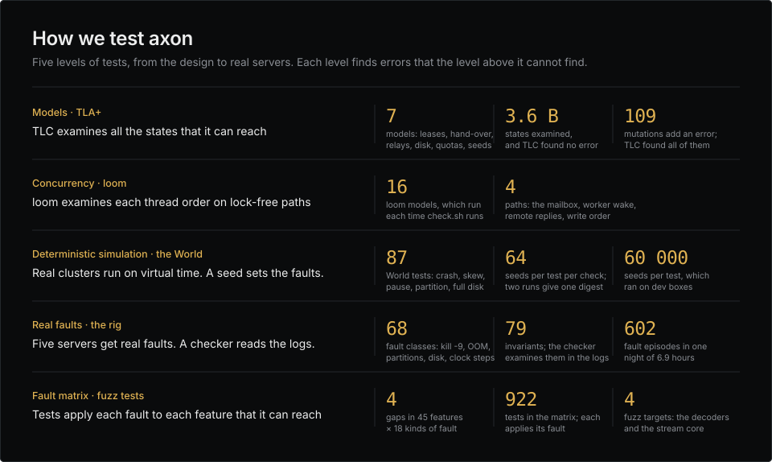
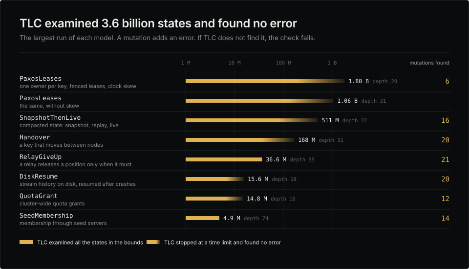
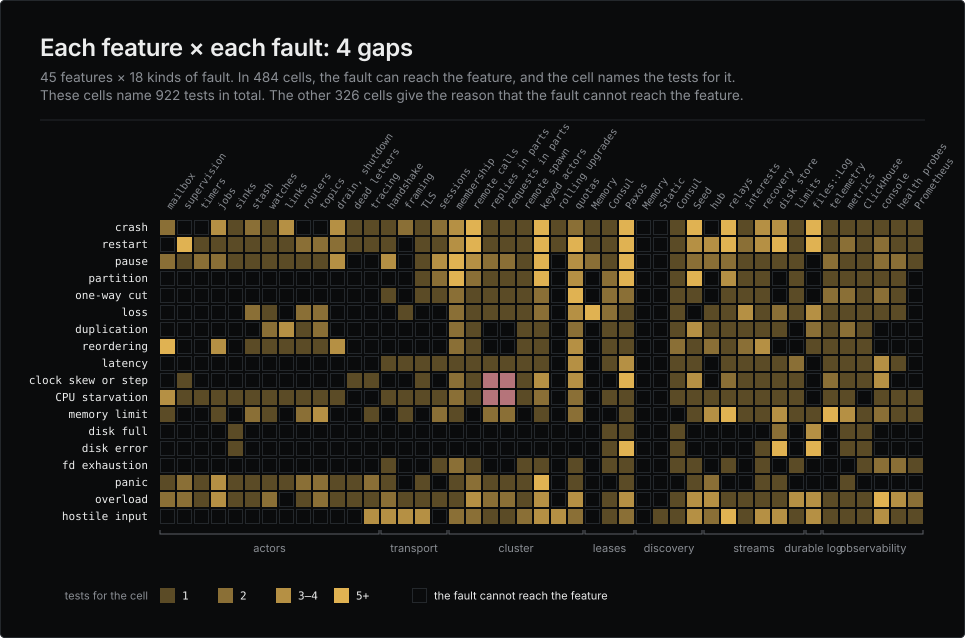
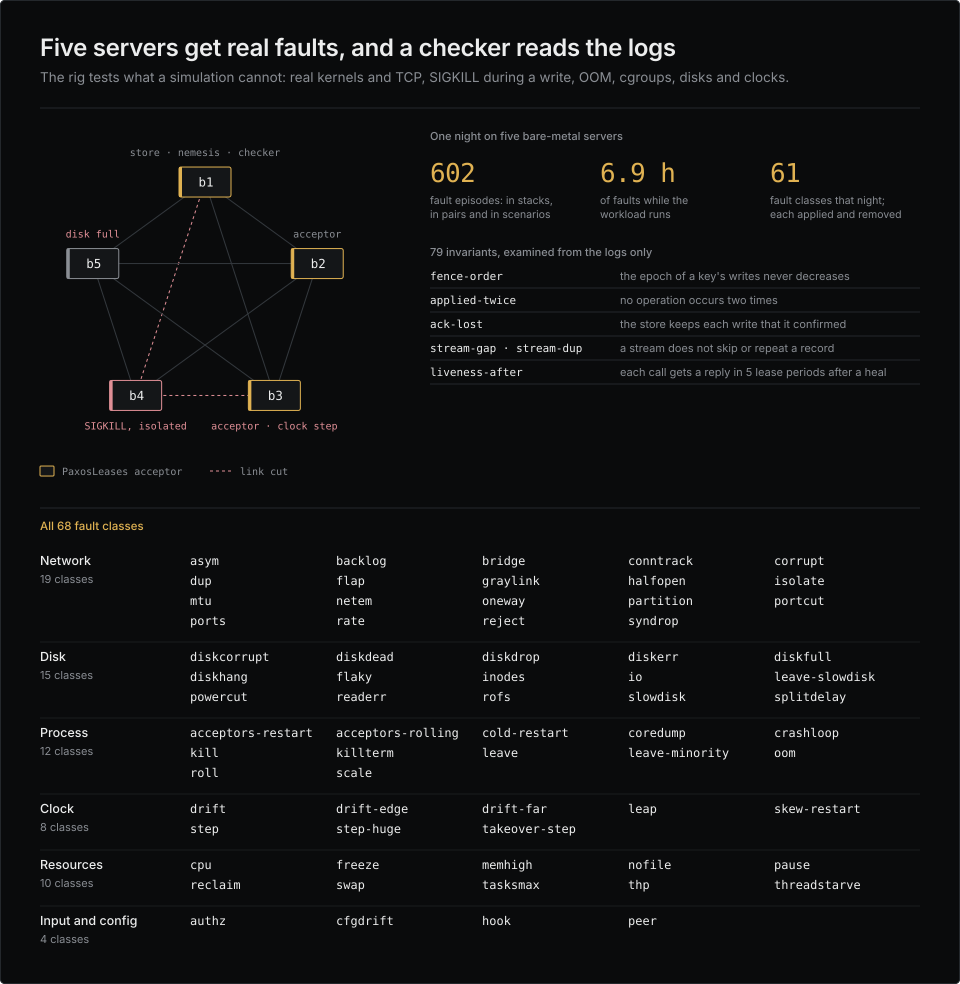

# axon

An actor framework for Rust: fast local actors, an authenticated cluster, ordered streams, and a built-in console to
see all of it.

```rust
use axon::{Actor, ActorSystem, Context, ReplyTo};

enum Command {
    Add(u64),
    Get(ReplyTo<u64>),
}

struct Counter(u64);

impl Actor for Counter {
    type Message = Command;
    type Error = &'static str;

    fn on_message(&mut self, msg: Command, _cx: &mut Context<'_, Self>) -> Result<(), Self::Error> {
        match msg {
            Command::Add(n) => self.0 += n,
            Command::Get(reply) => drop(reply.reply(self.0)),
        }
        Ok(())
    }
}

#[tokio::main]
async fn main() -> Result<(), Box<dyn std::error::Error>> {
    let system = ActorSystem::builder().build()?;
    let counter = system.spawn(Counter(0)).name("orders").start()?;

    counter.tell(Command::Add(10))?;               // never waits
    counter.send(Command::Add(32)).await?;         // waits for mailbox room
    assert_eq!(counter.ask(Command::Get).await?, 42);

    system.shutdown().await?;
    Ok(())
}
```

## What you get

**Actors** ([guide](crates/axon/guide/actors.md))
- Plain structs with synchronous handlers. One message at a time, so no locks in your code.
- Bounded mailboxes everywhere. A refused message is handed back; an accepted one is handled or reported.
- Supervision with restart budgets and backoff, timers, offloaded blocking and async work, graceful drain and
  shutdown.
- About 20 ns per message between threads ([benchmarks](crates/axon/guide/benchmarks.md), and a
  [comparison with other Rust actor libraries](https://actors.float64.cloud/)). Panics are contained per actor.
- Deterministic tests: drive one actor by hand with a manual clock, or a whole protocol over `axon-testkit`'s seeded
  network simulator. The runtime also works without tokio.
- Whole clusters on virtual time in the World: crashes, pauses, partitions and clock skew chosen by a seed that
  replays the run ([cluster § Simulating a cluster](crates/axon/guide/cluster.md#simulating-a-cluster)).

**Cluster** ([guide](crates/axon/guide/cluster.md))
- Call actors on other nodes by name with `tell`, `send` and `request`, each with a stated delivery promise.
- Spawn actors on other nodes, placed by labels. One actor per key across the cluster, rebalanced as nodes come and
  go, with optional fenced leases for strict single ownership: from Consul, or from acceptors among your own nodes
  (Paxos, a small log per acceptor, model-checked).
- Every connection is mutually authenticated (shared secret or mutual TLS), with optional TLS encryption and
  per-frame LZ4 or Zstd compression. The frame decoder is fuzzed.
- Discovery through axon's own seed servers (no outside service), Consul, a static list, or your own provider.
  Failure detection in about 4 seconds.
- Rate and concurrency limits per key, cluster-wide, that never wait
  ([cluster § Quotas](crates/axon/guide/cluster.md#quotas)).
- Rolling upgrades: sessions run the highest wire version both ends speak, and a name or a keyed kind serves two
  schemas side by side ([cluster § Rolling upgrades](crates/axon/guide/cluster.md#rolling-upgrades)).

**Streams** ([guide](crates/axon/guide/streams.md))
- Numbered records from one producer to many consumers across nodes: every record once and in order, or an explicit
  reset. Never a duplicate, never a silent gap.
- Resume from a cursor. Relay trees of any depth chosen by labels, with failover and loop detection.
- Compacted streams: the latest value per key, as a snapshot and then live
  ([streams § Compacted streams](crates/axon/guide/streams.md#compacted-streams)).
- History on disk at the origin, which resumes after a crash
  ([streams § History on disk](crates/axon/guide/streams.md#history-on-disk)).
- A websocket gateway: a session per socket, authentication, per-account limits, filters, resume
  ([streams § A websocket gateway](crates/axon/guide/streams.md#a-websocket-gateway)).

**Observability** ([guide](crates/axon/guide/observability.md))
- A web console embedded in the binary: topology, nodes, actors with per-message latency, connections, streams,
  traces, dead letters, events.
- Traces that follow a message across actors, nodes and streams.
- Metrics history in memory or ClickHouse, behind a small trait for other stores.
- Dead letters: every accepted message that was never handled, listed with its reason.
- Health probes (`/healthz`, `/readyz`) on every node, and Prometheus `/metrics` for a stock Prometheus to scrape
  ([observability § Prometheus](crates/axon/guide/observability.md#prometheus)).

## How it is tested



Each protocol that must always be correct has a TLA+ model: leases, hand-over, relays, disk resume, quotas and seed
membership. Each model has mutations. A mutation adds an error or makes a rule weaker. If TLC does not find each
mutation, `scripts/check.sh tla` fails ([spec/tla](spec/tla)).



The fault matrix shows each feature against each kind of fault. If a fault can reach a feature, the cell names the
tests for it. If a named test is not there, `scripts/check.sh` fails ([spec/faults.md](spec/faults.md)).



The World runs real nodes on virtual time. Thus, a seed gives the same crash, partition or clock step each time
([spec/simulation.md](spec/simulation.md)). The rig applies real faults to five servers, to test what a simulation
cannot. Then a checker examines only the logs for errors ([spec/fault-rig.md](spec/fault-rig.md)).



The figures use data from the spec and `spec/faults.md`. To draw them again, run `python3 scripts/readme-graphics.py`.

## Crates

| Crate | |
|---|---|
| `axon` | actors, runtime, `ActorSystem`, tracing context, dead letters |
| `axon-net` | authenticated, framed, compressed sessions over TCP and TLS |
| `axon-cluster` | discovery, membership, remote calls, remote spawn, keyed actors, leases, quotas; feature `consul` |
| `axon-stream` | ordered streams with replay, compacted state and history on disk; feature `cluster` to run them over a cluster |
| `axon-obs` | telemetry, metrics collection, console, health probes, Prometheus; features `dashboard`, `clickhouse`, `system-metrics` |
| `axon-testkit` | seeded network simulator for protocol tests: loss, duplicates, reordering, partitions, crashes; and the World, real clusters on virtual time over simulated wires |

Rust 1.99 or newer. `ActorSystem` and everything above it run on tokio.

The crates are not on crates.io. Depend on them by git at a release tag, using the same tag for every axon crate:

```toml
axon = { git = "https://github.com/AR1011/axon", tag = "v0.1.0" }
axon-cluster = { git = "https://github.com/AR1011/axon", tag = "v0.1.0", features = ["consul"] }
```


## See it run

```bash
cargo run -p axon-obs --features dashboard,system-metrics --example playground
```

That starts six nodes in one process with actors, remote calls, streams, traces and failures, and prints the
console's address on stdout. To keep history in ClickHouse, run `docker compose up -d` first, then the same command
with `--features dashboard,system-metrics,clickhouse` and `AXON_CLICKHOUSE=http://127.0.0.1:18123
AXON_CLICKHOUSE_USER=axon AXON_CLICKHOUSE_PASSWORD=axon-playground` set.

## Documentation

| | |
|---|---|
| [Actors](crates/axon/guide/actors.md) | messages, sending, lifecycle, supervision, timers, slow work, mailbox limits, testing |
| [Cluster](crates/axon/guide/cluster.md) | remote calls, remote spawn, keyed actors, membership, discovery, security, rolling upgrades, quotas, simulating a cluster |
| [Streams](crates/axon/guide/streams.md) | quick start, guarantees, relay trees, compacted streams, history on disk, a websocket gateway |
| [Observability](crates/axon/guide/observability.md) | console, health probes, Prometheus, ClickHouse, querying, tracing, dead letters |
| Reference | [telemetry catalog](crates/axon/guide/telemetry.md) · [dashboard API](crates/axon/guide/dashboard.md) · [tracing](crates/axon/guide/tracing.md) · [benchmarks](crates/axon/guide/benchmarks.md) |
| [API](crates/axon/README.md) | the API on one page, the rules that prevent most mistakes, which guide to read |
| [AGENTS.md](AGENTS.md) | for coding agents: rules, commands, the feature map |
| [spec/](spec/00-overview-and-requirements.md) | requirements and design decisions |

The code in the guides is compiled and run by the test suite, so it matches the API. The actors and cluster guides end
with their known limits, under "Things that trip people up".

## Develop

```bash
scripts/check.sh
```

Format, clippy with warnings denied, every test and doctest, doc links. About three minutes on a 24-thread box; CI runs the same script.
Coverage: `cargo llvm-cov --workspace --all-features --no-cfg-coverage`.

Every other command, and what it needs: [AGENTS.md](AGENTS.md).

## Licence

Apache License 2.0. See [LICENSE](LICENSE).
